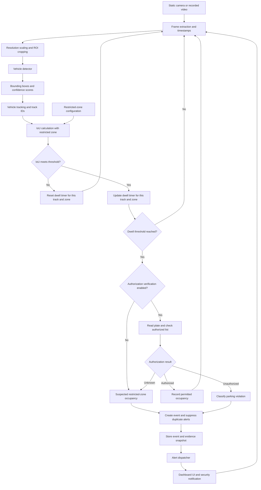

# System Architecture and Data Pipeline Specification

## 1. System Overview

The proposed system uses a static camera to monitor a reserved parking
space. It extracts and preprocesses video frames, detects vehicles,
and compares vehicle bounding boxes with the configured restricted zone.

The system tracks each vehicle across frames and measures how long it
remains within the restricted zone. When the configured dwell-time
threshold is reached, it creates a restricted-zone occupancy event and
displays an alert on the security dashboard.

If automatic license plate recognition is included, the system can
compare the detected plate with an authorized-vehicle list before
classifying the event as an unauthorized parking violation.

Without authorization verification, an alert indicates suspected
restricted-zone occupancy and requires confirmation by security staff.

## 2. Architecture Diagram

## 3. Component Explanations

### 3.1 Video Input
Accepts video from a fixed camera or a recorded video file. Recorded
video can be used for repeatable prototype testing.

### 3.2 Frame Extraction
Extracts frames at a configured processing rate. Each frame receives
a camera ID, frame ID, capture timestamp, and source elapsed time.

### 3.3 Preprocessing
Resizes the frame and optionally crops the monitored parking area.
The system records the transformation so detected vehicle coordinates
and restricted-zone coordinates remain consistent.

### 3.4 Vehicle Detection
A vehicle object detector produces bounding boxes, class labels, and
confidence scores. Detections below the configured confidence threshold
are discarded.

### 3.5 Vehicle Tracking
Associates detections across consecutive frames and assigns each vehicle
a track ID. The track ID connects vehicle observations to the correct
dwell timer.

### 3.6 Restricted-Zone Comparison
Calculates Intersection over Union between each vehicle bounding box
and the configured restricted zone. An overlap meeting the configured
threshold is treated as restricted-zone occupancy.

### 3.7 Dwell-Time Monitoring
Maintains a separate timer for each camera, vehicle track, and zone.
The timer begins when qualifying overlap is first observed and resets
when the vehicle is observed outside the zone.

### 3.8 Event Classification
Creates an event when the dwell threshold is reached. If authorization
verification is available, an unauthorized vehicle is classified as a
violation. An unreadable plate or unavailable authorization result
requires manual review.

### 3.9 Event Storage
Stores the event identifier, camera and zone identifiers, timestamps,
vehicle location, dwell duration, classification, and evidence snapshot.

### 3.10 Alert Dispatcher and Dashboard
Displays the event on the security dashboard and triggers the configured
security notification. Duplicate alerts are suppressed for the same
continuous occupancy event.

## 4. Interface Protocol Specification

| Interface | Data passed | Format or convention |
|---|---|---|
| Video input → Frame extraction | Video source and camera ID | Stream address or file path; camera ID string |
| Frame extraction → Preprocessing | Frame, frame ID, camera ID, timestamp, source elapsed time | Image array; integer frame ID; UTC timestamp; elapsed seconds |
| Preprocessing → Detector | Processed frame and transformation metadata | Image array; original and processed dimensions; crop offset; scaling factors |
| Detector → Tracker | Bounding boxes, classes, confidence scores | List of detections with `[x, y, w, h]`, class label, and confidence from 0 to 1 |
| Tracker → Zone comparison | Tracked vehicle detections | Track ID and bounding box mapped to original-frame coordinates |
| Zone configuration → Zone comparison | Zone ID, zone bounds, overlap threshold | Zone ID string; rectangle `[x, y, w, h]`; threshold from 0 to 1 |
| Zone comparison → Timer | Track ID, zone ID, IoU, occupancy state, source elapsed time | Numeric IoU; Boolean occupancy state; elapsed seconds |
| Timer → Classifier | Occupancy start time and dwell duration | UTC start timestamp; dwell duration in seconds |
| Authorization check → Classifier | Plate text and authorization result | Plate string or null; authorized, unauthorized, or unknown |
| Classifier → Event storage | Event details and snapshot reference | Structured event record |
| Event storage → Dispatcher | Stored event and delivery status | JSON-compatible record with unique event ID |
| Dispatcher → Dashboard | Alert details and evidence reference | Event ID, classification, location, timestamps, dwell duration, snapshot reference |

## 5. Processing Rules and Configuration

### 5.1 Bounding-Box Format

Bounding boxes use `[x, y, w, h]`, where:

- x is the horizontal coordinate of the top-left corner.
- y is the vertical coordinate of the top-left corner.
- w is the box width.
- h is the box height.

Coordinates are measured in pixels from the top-left of the image.
All overlap calculations use original-frame coordinates. Detections
from resized or cropped frames are mapped back before comparison.

The prototype represents the restricted zone as a rectangle using
the same coordinate convention.

### 5.2 Intersection over Union

IoU = intersection area / union area

Union area = vehicle box area + zone area - intersection area

An IoU at or above the configured threshold qualifies as zone occupancy.
The threshold must be tuned using the selected camera view because
vehicle and parking-space sizes affect the score.

### 5.3 Timestamp Convention

Event timestamps use ISO 8601 UTC, for example:

2026-10-04T22:30:00.000Z

Dwell duration uses elapsed source time rather than a frame count.
For recorded video, source elapsed time comes from the video timeline.
For a live camera, it uses a monotonic elapsed-time clock.

### 5.4 Initial Prototype Settings

- Processing rate: 5 frames per second.
- Detection confidence threshold: 0.50.
- Restricted-zone IoU threshold: 0.20.
- Dwell-time threshold: 30 seconds.
- Tracking-loss grace period: 2 seconds.

These values are initial design settings, not measured performance
results. They will be adjusted during testing.

### 5.5 Timer and Alert Rules

1. Maintain a timer for each camera ID, track ID, and zone ID.
2. Start the timer at the first qualifying overlap observation.
3. Update dwell duration while qualifying overlap continues.
4. Reset the timer when the tracked vehicle is observed outside the zone.
5. Preserve the timer during a tracking loss of up to 2 seconds.
6. If tracking loss exceeds 2 seconds, reset the timer and record that
   continuous occupancy could not be confirmed.
7. Create an event after 30 seconds of qualifying occupancy.
8. Issue one alert per continuous occupancy event.
9. Clear the active event when the vehicle leaves or the track expires.
10. Treat camera interruption as unavailable monitoring, not an empty space.

## 6. Example Event Sequence

1. The camera captures a vehicle entering the reserved parking space.
2. The detector identifies the vehicle and returns its bounding box.
3. The tracker assigns track ID 12.
4. The zone comparison calculates an IoU of 0.35.
5. Since 0.35 exceeds the configured threshold of 0.20, the dwell timer starts.
6. At 10 seconds, the system continues monitoring without an alert.
7. At 30 seconds, the classifier creates an occupancy event.
8. If authorization verification confirms an unauthorized vehicle,
   the event is classified as a parking violation.
9. If authorization is unavailable, the event is marked for manual review.
10. The system saves a snapshot and displays the alert on the dashboard.
11. Continued occupancy does not generate repeated alerts.
12. When the vehicle leaves, the timer and active event are cleared.